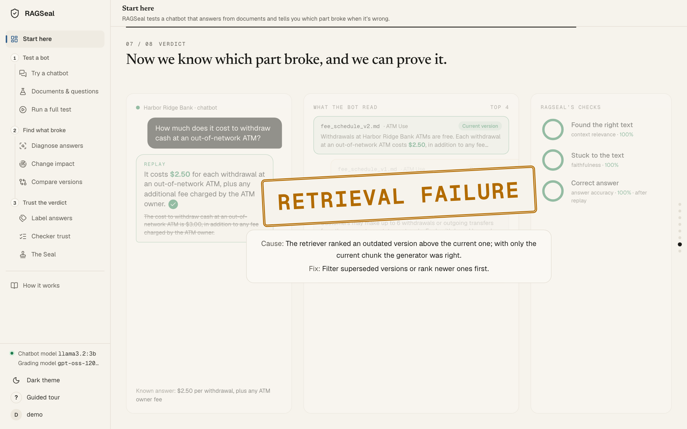
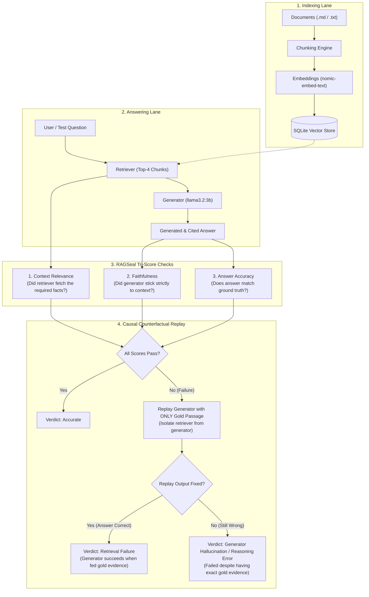
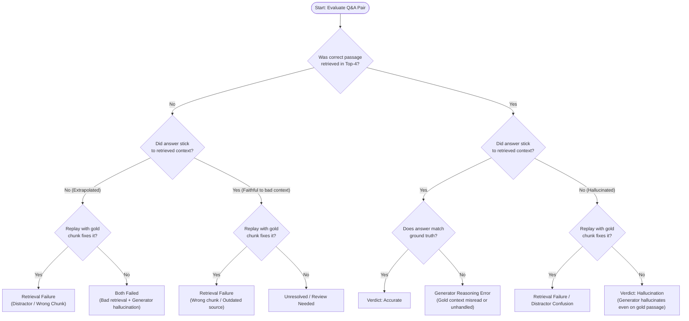
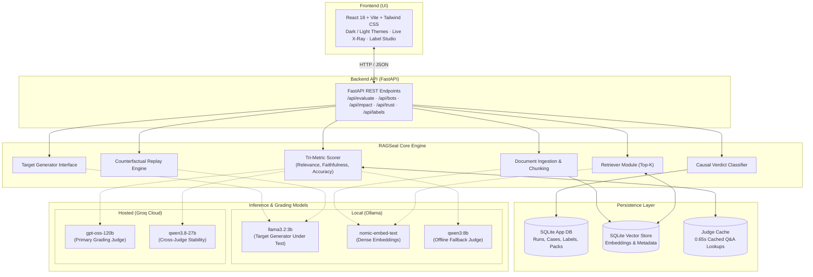

<div align="center">

# RAGSeal

### *When a RAG answer is wrong, RAGSeal proves whether the retriever or the generator caused it.*

[](https://www.python.org/)
[](https://fastapi.tiangolo.com/)
[](https://react.dev/)
[](https://www.typescriptlang.org/)
[](https://ollama.com/)
[](https://groq.com/)
[](https://www.sqlite.org/)
[](LICENSE)

**HYPNEXIS'26 Hackathon** · Problem Statement **AI-04** · Team **Monster Energy**

</div>

---

## Overview



### The Problem
* **Failure Ambiguity**: When a RAG answer is incorrect, hallucinations and retrieval misses look identical from the outside. Teams waste days blaming the LLM when vector search missed the relevant chunk, or tweaking chunk sizes when the generator simply fabricated information.
* **Black-Box Metrics**: End-to-end evaluation metrics (BLEU, ROUGE, or opaque LLM grades) only tell you *that* an answer failed, never *which component failed* or *why*.
* **Guesswork Debugging**: Without causal counterfactual proof, teams fix bugs by intuition—often introducing silent regressions across document revisions.

**RAGSeal** is an open-source evaluation laboratory that decomposes RAG pipelines into isolated retriever and generator checks, runs automated counterfactual replays with isolated gold context, and delivers deterministic causal verdicts.

---

## How It Works



---

## Verdict Decision Tree

When a test case fails, RAGSeal traverses a deterministic decision tree and isolates the root cause via counterfactual replay:



### The 9 Failure Types

| Failure Type | Category | Description |
|---|---|---|
| `wrong_chunk` | Retriever | Retriever fetched irrelevant sections; gold evidence was omitted from top-4 results. |
| `outdated_source` | Retriever | Retriever pulled a deprecated document revision instead of the active policy. |
| `distractor_confusion` | Retriever | Retriever fetched an adversarial distractor chunk that lured the generator away. |
| `ignored_context` | Generator | Gold passage was retrieved in top-4, but the generator completely ignored it. |
| `hallucination` | Generator | Generator invented claims, dates, or numbers unsupported by any retrieved chunk. |
| `reasoning_error` | Generator | All evidence was present, but the generator miscalculated, miscompared, or erred in logic. |
| `should_have_abstained` | Generator | Query was unanswerable from the corpus, but the generator fabricated an answer anyway. |
| `wrongly_abstained` | Generator | Evidence was present in retrieved chunks, but the generator refused to answer. |
| `unresolved` | Pipeline | Ambiguous edge case where replay and scoring do not reach clear causal consensus. |

---

## Architecture



---

## Features

| Feature / Page | Description | Screenshot Slot |
|---|---|---|
| **Bots Under Test (Live X-Ray)** | Real-time inspection of bot prompts, retrieval chunks, token citations, and answer generation. | `docs/assets/bots.png` |
| **Diagnose** | Deep-dive root-cause explorer showing context relevance, faithfulness, accuracy, and counterfactual replay proofs. | `docs/assets/diagnose.png` |
| **Documents & Question Generator** | Ingest markdown/text documents and automatically generate synthetic ground-truth test Q&A pairs. | `docs/assets/testsets.png` |
| **Change Impact Radar** | Diff two document revisions (e.g. v1 vs v2 policy) and instantly identify stale answers and at-risk questions. | `docs/assets/impact.png` |
| **Full Test Run with Live Progress** | Run batch evaluation suites across packs with live progress streaming, pass rates, and failure tracking. | `docs/assets/runs.png` |
| **Label Studio** | Blind two-person human annotation interface to establish gold standards and measure pipeline vs human agreement. | `docs/assets/labels.png` |
| **Evaluator Trust** | Full statistical transparency: pipeline-vs-human agreement, confusion matrices, and judge-swap stability. | `docs/assets/trust.png` |
| **Compare Versions** | Rigorous version comparison using McNemar paired tests and bootstrap confidence intervals to prove improvements. | `docs/assets/compare.png` |
| **The Seal** | Verifiable trust certificate and embeddable SVG/Markdown badge confirming production RAG reliability. | `docs/assets/seal.png` |
| **Light & Dark Themes** | Seamless theme switching built natively into the application shell for optimal contrast. | *Integrated in UI* |

---

## Evaluation Results & Benchmarks

All benchmark metrics reflect verified experimental results:

### 1. Evaluator Reliability & Human Agreement
* **Human Label Consensus**: **213 answers** independently evaluated by two human labellers.
  * Pipeline vs Human Consensus Agreement: **95.0%**
  * Critical Safety Metric: **0 false passes** ($n = 160$ clean pass cases).
* **Fault Injection Validation**: **54 planted failures** across diverse edge cases:
  * Exact failure type pinpointed: **89%** ($48/54$).
  * Correct pipeline stage isolated (Retriever vs Generator): **96%** ($52/54$).
* **Judge Stability & Swap**:
  * Cross-model judge swap (`qwen3.8-27b` vs `gpt-oss-120b`): **20/20 verdicts identical** ($\kappa = 1.0$).
  * Prompt shuffle invariance: **Score change = 0.0**.
  * Full suite re-score consistency: **211/213 verdicts unchanged**.
* **External Benchmark Validation**:
  * Validated against **RAGTruth** (*Niu et al., ACL 2024*): **Recall: 0.917**, **Precision: 0.733**, **F1: 0.815** ($n = 48$).

### 2. Version Comparison & Impact Radar
* **Real IRS Document Version Compare**:
  * Baseline vs Updated: **70% → 75%** pass rate.
  * 95% Confidence Interval: **[−15, +25] points**.
  * McNemar test significance: **$p = 1.0$** (indicates no statistically meaningful change; 3 fixed, 2 broken).
* **Change Impact (Banking Fee Schedule v1 → v2)**:
  * Detected **5 changed facts** between versions.
  * Flagged **2 answers at immediate risk** of delivering stale information.

### 3. Built-In Industry Packs
| Benchmark Pack | Questions | Pass Rate | Primary Failure Modes Tested |
|---|---|---|---|
| **Banking** | 71 | **86%** | Fee updates, loan terms, distractor accounts |
| **Recruitment** | 71 | **89%** | Candidate qualifications, salary bans, policy traps |
| **Healthcare** | 71 | **93%** | Drug interactions, dosage guidelines, contraindications |
| **Real IRS Documents** | 22 | **72.7%** | Mileage rates & retirement limits across 2025/2026 revisions |
| **RAGSeal Guide** | 14 | **78.6%** | Architecture self-test, taxonomy boundaries, replay mechanics |

### 4. Throughput & Latency
* **Cold Free-Tier API Throughput**: ~8–10 questions/minute on standard free API rate limits.
* **Cached Evaluation Latency**: **0.65 seconds / question** with SQLite judge caching enabled.
* *Honesty Note*: Evaluating 200 questions cold within 15 minutes requires multiple API keys or a dedicated paid tier.

---

## Quickstart

### Prerequisites
* **Python**: 3.11 or newer
* **Node.js**: 18.x or newer
* **Ollama**: Installed and running locally with the required models:
  ```bash
  ollama pull llama3.2:3b
  ollama pull nomic-embed-text
  ollama pull qwen3:8b
  ```

### 1. Backend Setup
1. Create your environment configuration:
   ```bash
   cp .env.example backend/.env
   ```
2. Configure your Groq API key in `backend/.env`:
   ```ini
   GROQ_API_KEY=gsk_your_groq_api_key_here
   # Optional fallback keys for higher concurrency:
   # GROQ_API_KEY_2=gsk_...
   # GROQ_API_KEY_3=gsk_...
   ```
3. Start the FastAPI backend server:
   ```bash
   uvicorn app.main:app --app-dir backend --port 8000
   ```
   *The backend will be available at `http://localhost:8000` (API docs at `http://localhost:8000/docs`).*

### 2. Frontend Setup
In a new terminal window:
```bash
cd frontend
npm ci
npm run dev
```
*Open `http://localhost:5173` in your browser.*

### 3. Demo Credentials
Log in to the dashboard using the pre-configured demo account:
* **Email**: `demo@ragseal.dev`
* **Password**: `demo1234`

---

## Repository Structure

```
├── .github/                       # GitHub issue & PR templates
│   ├── ISSUE_TEMPLATE/            # Bug report and feature request templates
│   └── PULL_REQUEST_TEMPLATE.md   # Standard pull request checklist
├── backend/                       # FastAPI web service & persistence layer
│   ├── app/
│   │   ├── routers/               # Endpoints (/evaluate, /bots, /impact, /trust, /labels)
│   │   ├── database.py            # SQLite database schema & connection management
│   │   └── main.py                # FastAPI application entrypoint
│   └── tests/                     # Backend API & router test suite
├── docs/                          # Architecture guides & specifications
│   ├── assets/                    # UI screenshots and visual assets
│   ├── api_contract.md            # API contracts, metrics schema, & fault taxonomy
│   ├── product_brief.md           # Product philosophy & hackathon deliverables
│   ├── frontend_integration_notes.md # Pack evaluation & batch API integration
│   ├── nvidia_nim_apis.md         # Reference guide for hosted inference & embeddings
│   └── team_tasks_members_3_4.md  # Test packs, human labelling, & pitch task list
├── engine/                        # Core algorithmic evaluation engine
│   ├── compare.py                 # McNemar test & bootstrap confidence interval logic
│   ├── impact.py                  # Document diff & change impact radar engine
│   ├── inject.py                  # Fault injection & synthetic error harness
│   ├── stability.py               # Judge swap & evaluator consistency testing
│   ├── external_validation.py     # RAGTruth benchmark validation harness
│   ├── packs_builtin/             # Built-in packs (Banking, Recruitment, Healthcare, IRS)
│   └── tests/                     # Unit & regression tests for core evaluation engine
├── frontend/                      # React 18 + Vite web application
│   ├── src/
│   │   ├── components/ragseal/    # RAGSeal UI pages (Bots, Diagnose, Impact, Trust, Seal)
│   │   ├── components/ui/         # Primitives and shared UI components
│   │   ├── lib/api.ts             # Typed API client for FastAPI backend
│   │   └── types/ragseal.ts       # Shared TypeScript schemas and interfaces
│   └── package.json               # Node dependencies and build scripts
├── CONTRIBUTING.md                # Development guidelines & PR conventions
└── README.md                      # Repository centerpiece documentation
```

---

## Honesty & Prior Art

* **Prior Art**: RAGSeal builds upon concepts pioneered by frameworks like **Ragas**, **RAGChecker**, **TruLens**, **DeepEval**, and **ARES**.
* **What Makes RAGSeal Distinct**:
  1. **Automated Counterfactual Replay**: Rather than relying purely on LLM heuristic grading, RAGSeal isolates the retriever by re-running the generator with *only* the verified gold chunk to causally prove retriever vs generator fault.
  2. **Inter-Annotator Agreement Grounding**: Transparently benchmarked against double-blind human annotations ($95.0\%$ agreement, 0 false passes).
  3. **Fault-Injection Confusion Matrix**: Rigorously validated with 54 planted failure cases to verify diagnostic accuracy.
  4. **Document Change Impact Radar**: Directly calculates semantic diffs between document versions to prevent regressions before deployment.
* **Benchmark Transparency**: Industry packs (Banking, Recruitment, Healthcare) feature synthetic documents and fictional organizations designed to probe edge cases; the IRS pack uses real, unedited public-domain IRS releases.

---

## Team & Credits

Built with pride by **Team Monster Energy** for **HYPNEXIS'26** (Problem Statement **AI-04**).

* **Vidhaath**: Frontend engineering, interactive diagnostic lab, UI components & architecture presentation
* **Sarthak**: Backend API orchestration, core evaluation engine, counterfactual replay & statistical tests
* **Presentation & Data Team**: Industry test packs, double-blind human labels, and pitch materials

**Contact**: `govidanidarsh@gmail.com`
